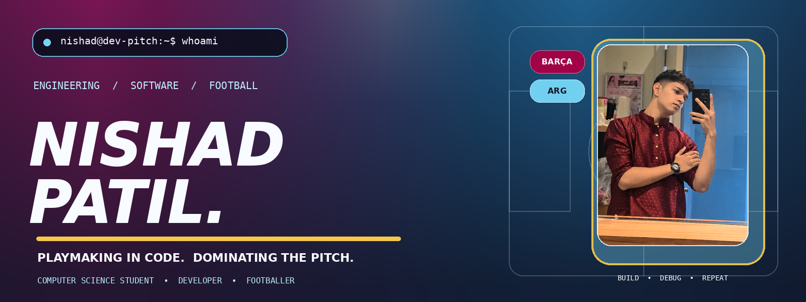
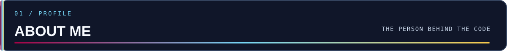
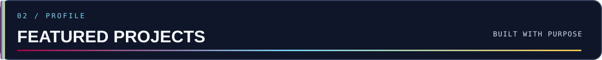
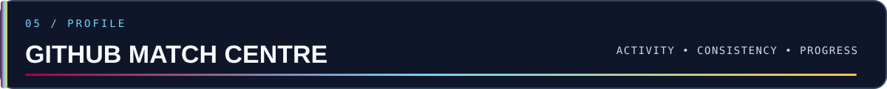
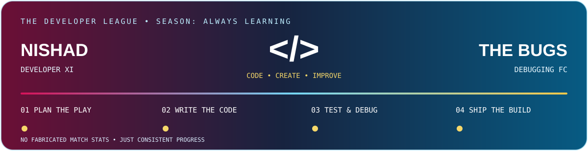
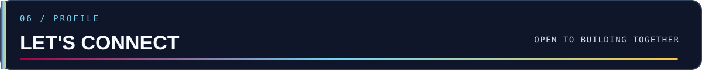

<!-- Nishad Patil | GitHub Profile README | Barça × Argentina × Coding -->

  

  
  
  

  

- 🔭 I’m currently working to **improve my Python and C++ skills**
- 🌱 I’m currently learning **Core Computer Science concepts and Software Development**
- 👯 I’m looking to collaborate on **Python-based projects and Frontend initiatives**
- 🤝 I’m looking for help with **advanced data structures and algorithms in C++**
- 📫 How to reach me **[nishadpatil2008@gmail.com](mailto:nishadpatil2008@gmail.com)**
- ⚡ Fun fact: **When I'm not writing code, you can usually find me playing football, hitting the gym, or editing videos!**

### Connect with me

  
  
  
  

| Project | Description |
|---|---|
| [CareerCompiler AI](https://github.com/NishadCodes18/CareerCompiler-AI) | An AI-powered career compilation and resume building tool. |
| [DocuSphere AI](https://github.com/NishadCodes18/DocuSphere-Ai) | An AI-driven document management and processing platform. |
| [PT Tracker CRM](https://github.com/NishadCodes18/PT-TRACKER-WEBSITE) | A web application for personal trainers to manage clients, payments, renewals, and business finances. |
| [S.U.T.R.A.](https://github.com/NishadCodes18/S.U.T.R.A.-Moving-Traffic-Saving-Lives) | Moving Traffic, Saving Lives. A traffic management and optimization project. |
| [Gym Website](https://github.com/NishadCodes18/Gym-Website) | A clean and simple website built for a gym. |

📂 **[View my complete collection of certificates and solved challenges here!](https://github.com/NishadCodes18/Certifications-Challenges-And-Achievements)**

  

### 🌟 Top Highlights
* 🏆 **[FOSSEE Open Source Hardware Hackathon 2026](https://github.com/NishadCodes18/Certifications-Challenges-And-Achievements/blob/main/FOSSEE%20IIT%20BOMBAY%20HACKATHON%20CERTIFICATE.pdf)** - *IIT Bombay*
* 🎓 **[Artificial Intelligence & Machine Learning Certification](https://github.com/NishadCodes18/Certifications-Challenges-And-Achievements/blob/main/Artificial%20Intelligence%20%26%20Machine%20Learning%20Certification%20-%20Bhartiya%20Skill%20Development%20University,%20Jaipur_rotated-1.pdf)** - *Bhartiya Skill Development University, Jaipur*
* 🚀 **[Data Structures in C++ Course](https://github.com/NishadCodes18/Certifications-Challenges-And-Achievements/blob/main/scaler%20certificate.png)** - *Scaler*
* 📊 **[Python and SQL for Data Science](https://github.com/NishadCodes18/Certifications-Challenges-And-Achievements/blob/main/scaler%20python%20and%20sql%20for%20data%20science.jpeg)** - *Scaler*
* 🗄️ **[SQL for Beginners: MySQL and Database Design](https://github.com/NishadCodes18/Certifications-Challenges-And-Achievements/blob/main/sql%20for%20beginner.jpeg)** - *Scaler*

### 🧠 Machine Learning & Data

### 🌐 Web & Software Engineering

### 🔧 Tools & Platforms

  

  

 

  
  
  
  
  
  

<strong>⚽ Think like a player. Build like an engineer. Improve every day.</strong>

