<!--
Nishad Patil | GitHub Profile
Visual identity: FC Barcelona garnet × Argentina sky blue × software × football × fitness.
No floating balls, orbs, cursor glows, or fast decorative movement.
-->

  <a href="https://nishadcodes18-portfolio.vercel.app/">
    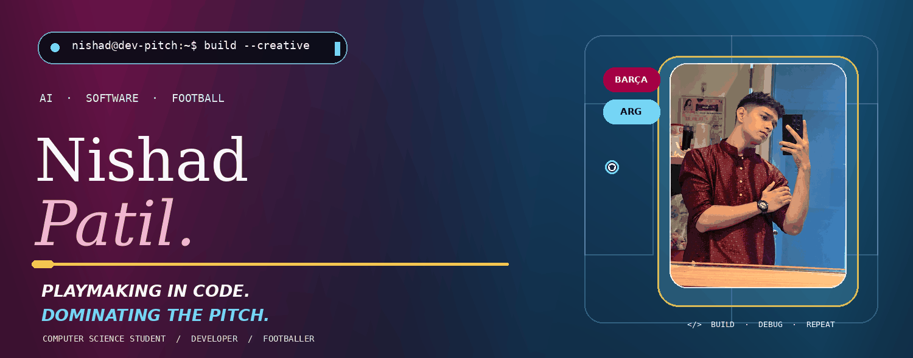
  </a>

  
  
  

  

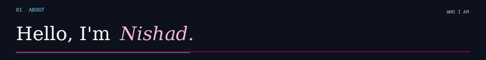

  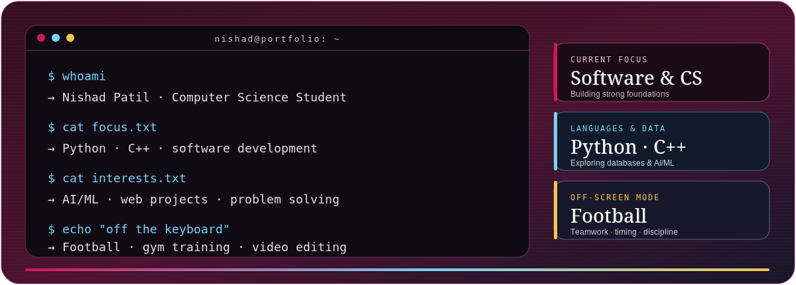

I'm **Nishad Patil**, an Integrated B.Tech Computer Science and Engineering student at **MIT World Peace University, Pune**. I enjoy building practical software, exploring AI/ML, and strengthening my foundations in computer science.

- 🔭 I’m currently working to **improve my Python and C++ skills**.
- 🌱 I’m currently learning **Core Computer Science concepts and Software Development**.
- 👯 I’m looking to collaborate on **Python-based projects and Frontend initiatives**.
- 🤝 I’m looking for help with **advanced data structures and algorithms in C++**.
- 📫 How to reach me **[nishadpatil2008@gmail.com](mailto:nishadpatil2008@gmail.com)**.
- ⚽ **Football:** I enjoy the game, teamwork, positioning and the competitive side of sport.
- 🏋️ **Gym:** Training keeps me consistent, disciplined and focused on progress.
- 🎬 **Creative side:** Video editing and visual storytelling.

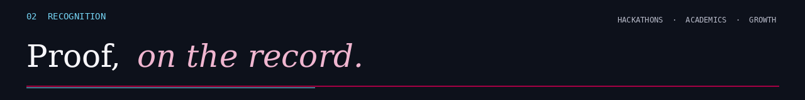

  <a href="https://github.com/NishadCodes18/Certifications-Challenges-And-Achievements">
    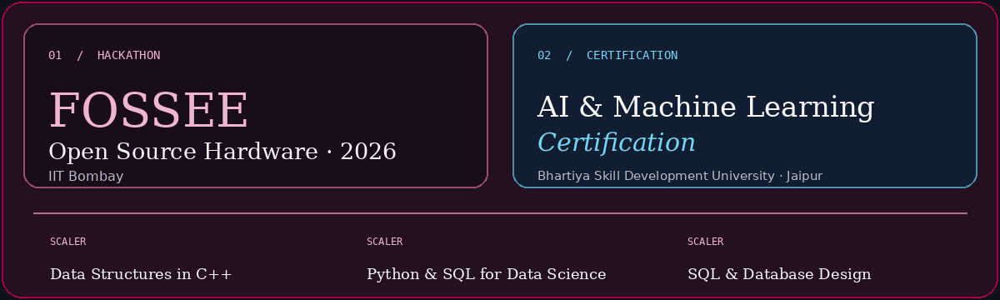
  </a>

  

### 🌟 Top Highlights
- 🏆 **[FOSSEE Open Source Hardware Hackathon 2026](https://github.com/NishadCodes18/Certifications-Challenges-And-Achievements/blob/main/FOSSEE%20IIT%20BOMBAY%20HACKATHON%20CERTIFICATE.pdf)** — *IIT Bombay*
- 🎓 **[Artificial Intelligence & Machine Learning Certification](https://github.com/NishadCodes18/Certifications-Challenges-And-Achievements/blob/main/Artificial%20Intelligence%20%26%20Machine%20Learning%20Certification%20-%20Bhartiya%20Skill%20Development%20University,%20Jaipur_rotated-1.pdf)** — *Bhartiya Skill Development University, Jaipur*
- 🚀 **[Data Structures in C++ Course](https://github.com/NishadCodes18/Certifications-Challenges-And-Achievements/blob/main/scaler%20certificate.png)** — *Scaler*
- 📊 **[Python and SQL for Data Science](https://github.com/NishadCodes18/Certifications-Challenges-And-Achievements/blob/main/scaler%20python%20and%20sql%20for%20data%20science.jpeg)** — *Scaler*
- 🗄️ **[SQL for Beginners: MySQL and Database Design](https://github.com/NishadCodes18/Certifications-Challenges-And-Achievements/blob/main/sql%20for%20beginner.jpeg)** — *Scaler*

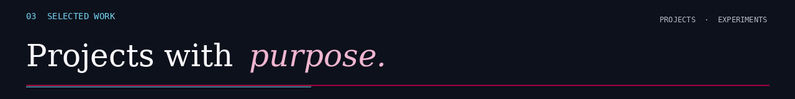

<a href="https://github.com/NishadCodes18/CareerCompiler-AI">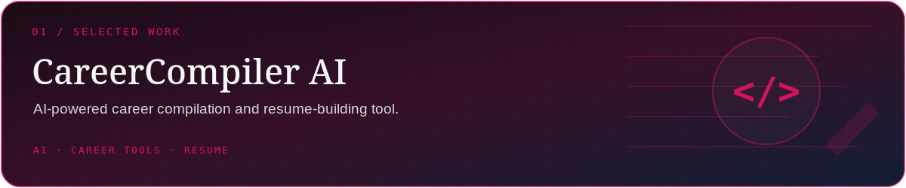</a>

<a href="https://github.com/NishadCodes18/DocuSphere-Ai">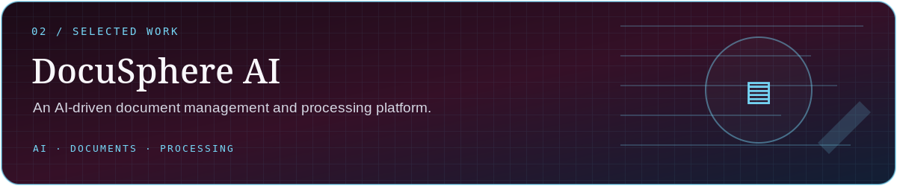</a>

<a href="https://github.com/NishadCodes18/PT-TRACKER-WEBSITE">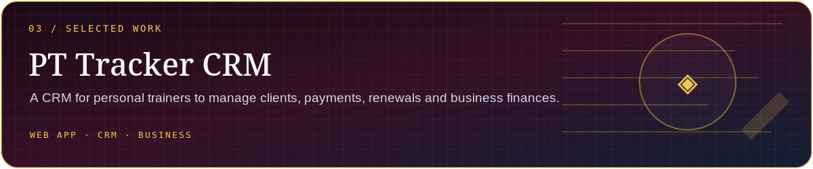</a>

<a href="https://github.com/NishadCodes18/S.U.T.R.A.-Moving-Traffic-Saving-Lives">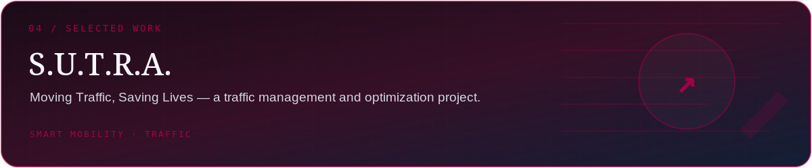</a>

<a href="https://github.com/NishadCodes18/Gym-Website">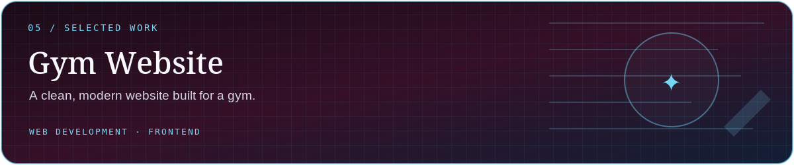</a>

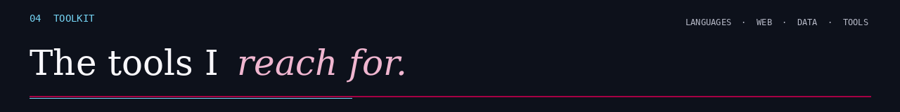

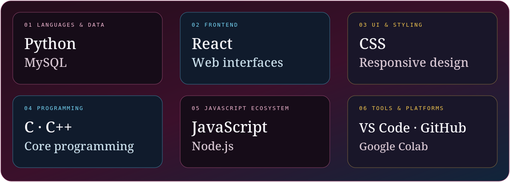

### 🧠 Machine Learning & Data

### 🌐 Web & Software Engineering

### 🔧 Tools & Platforms

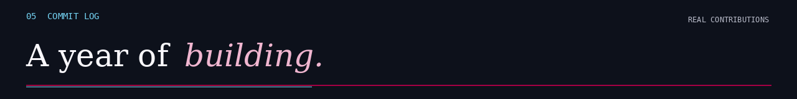

  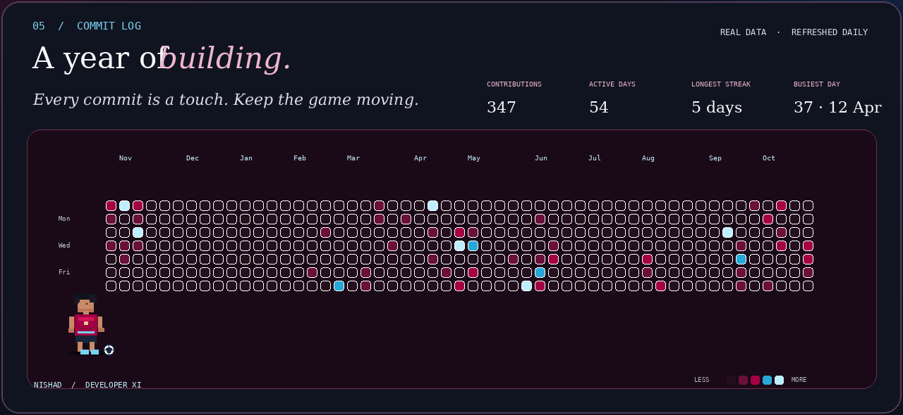

  
  

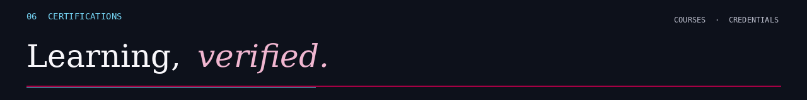

  

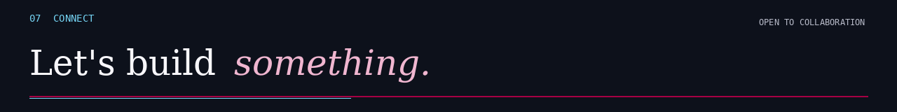

  
  
  
  
  
  

<em>⚽ Think like a player. Train like an athlete. Build like an engineer.</em>

<a href="https://github.com/NishadCodes18">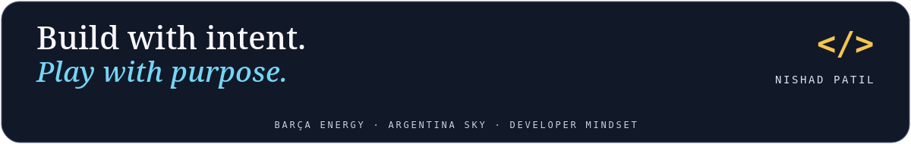</a>

