<!--
Nishad Patil | GitHub Profile
Visual identity matches nishadcodes18-portfolio.vercel.app: black, white and one accent red (#ff2a2a),
muted grey #8a8a8a, hairlines rgba(255,255,255,.12). Anton display, Manrope body, JetBrains Mono labels.
Numbered "(0X)" section labels and footballer language ("Playmaking in code.").
Images are rendered by scripts/build_profile_assets.py; the contribution GIF by
scripts/generate_football_contributions.py (refreshed daily by .github/workflows/snake.yml).
-->

  <a href="https://nishadcodes18-portfolio.vercel.app/">
    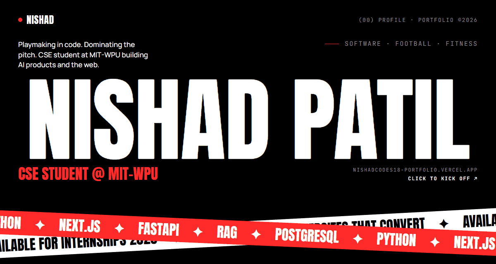
  </a>

  
  
  

  

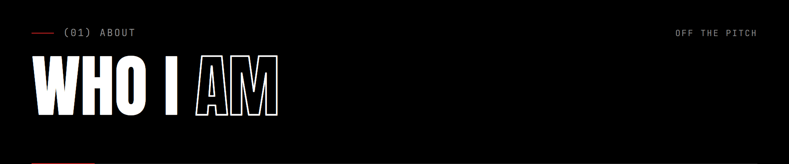

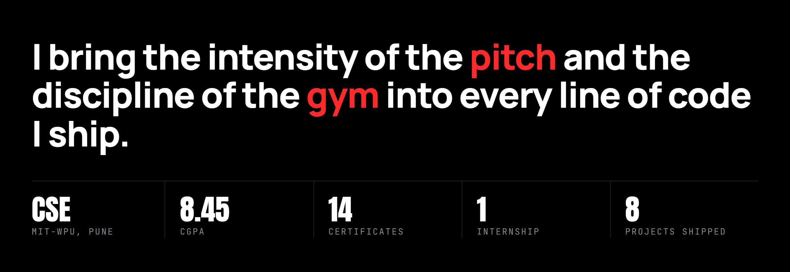

I'm **Nishad Patil**, an Integrated B.Tech Computer Science and Engineering student at **MIT World Peace University, Pune**, a competitive footballer and a dedicated gym regular. From leading teams in high-pressure hackathons to shipping full-stack and AI applications, I like the place where technical excellence meets leadership.

**Open to opportunities:** internships, freelance AI and website projects, and engineering roles.

| | |
|---|---|
| `NOW` | Sharpening **Python and C++**; learning **core CS and software development** |
| `COLLAB` | **Python projects** and **frontend** work |
| `ASK` | Advanced **data structures and algorithms in C++** |
| `OFF THE PITCH` | ⚽ Football: teamwork, positioning, the competitive side · 🏋️ Gym: consistency and progress · 🎬 Video editing and visual storytelling |
| `REACH` | [nishadpatil2008@gmail.com](mailto:nishadpatil2008@gmail.com) |

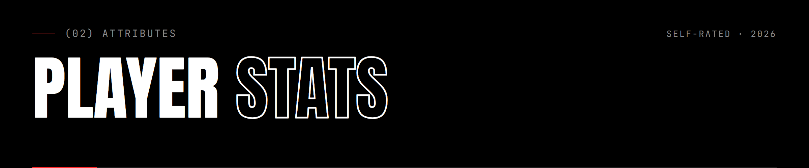

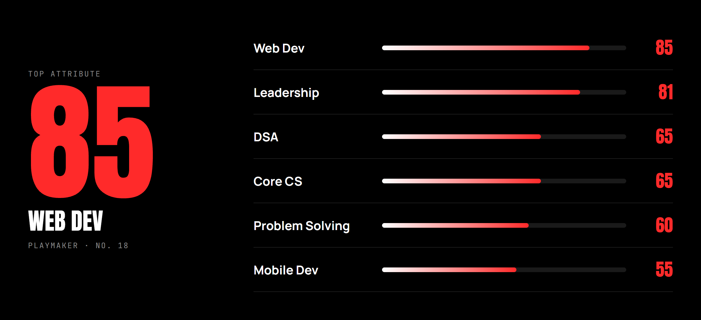

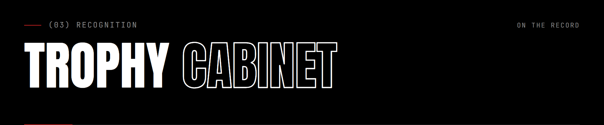

<a href="https://github.com/NishadCodes18/Certifications-Challenges-And-Achievements">
  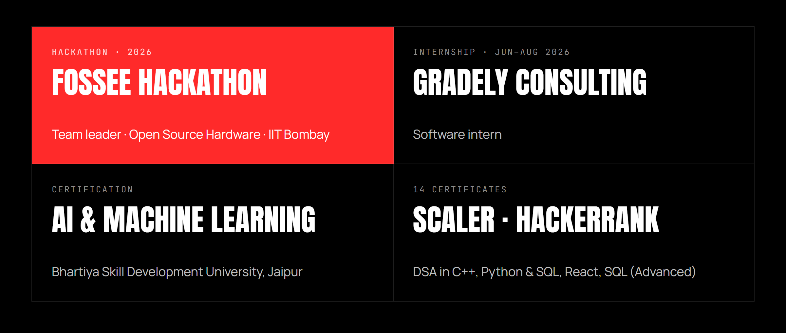
</a>

- **[FOSSEE Open Source Hardware Hackathon 2026](https://github.com/NishadCodes18/Certifications-Challenges-And-Achievements/blob/main/FOSSEE%20IIT%20BOMBAY%20HACKATHON%20CERTIFICATE.pdf)** · team leader · *IIT Bombay*
- **[Artificial Intelligence & Machine Learning Certification](https://github.com/NishadCodes18/Certifications-Challenges-And-Achievements/blob/main/Artificial%20Intelligence%20%26%20Machine%20Learning%20Certification%20-%20Bhartiya%20Skill%20Development%20University,%20Jaipur_rotated-1.pdf)** · *Bhartiya Skill Development University, Jaipur*
- **[Data Structures in C++](https://github.com/NishadCodes18/Certifications-Challenges-And-Achievements/blob/main/scaler%20certificate.png)** · *Scaler*
- **[Python and SQL for Data Science](https://github.com/NishadCodes18/Certifications-Challenges-And-Achievements/blob/main/scaler%20python%20and%20sql%20for%20data%20science.jpeg)** · *Scaler*
- **[SQL for Beginners: MySQL and Database Design](https://github.com/NishadCodes18/Certifications-Challenges-And-Achievements/blob/main/sql%20for%20beginner.jpeg)** · *Scaler*

  

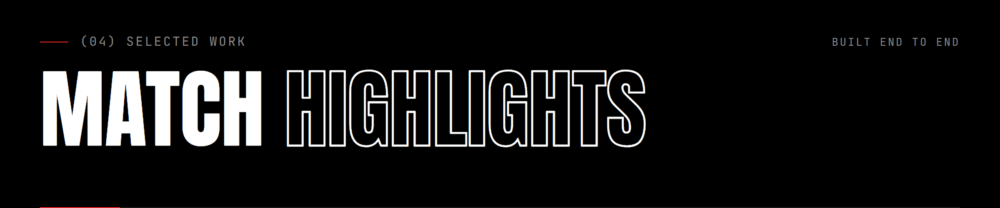

<a href="https://github.com/NishadCodes18/DocuSphere-Ai">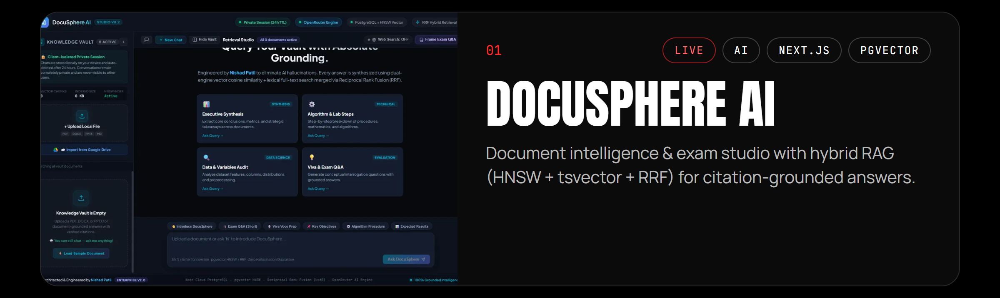</a>

  
  

<a href="https://github.com/NishadCodes18/ACRe-AI-Powered-Cyber-Resilience-Engine">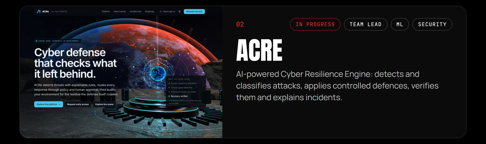</a>

  
  
  

<a href="https://www.thezone360fitnessbalewadi.in/">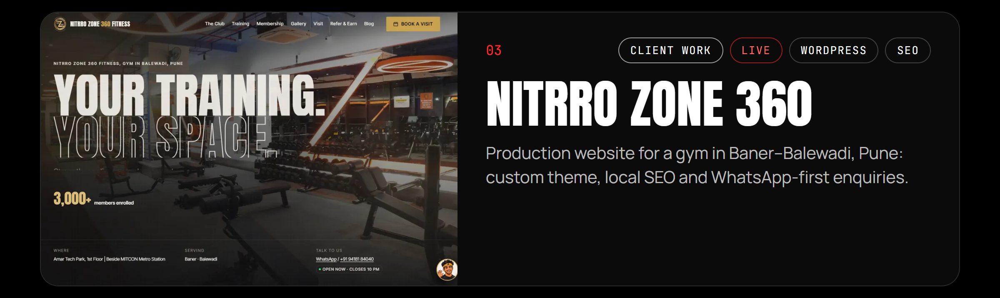</a>

  

<a href="https://github.com/NishadCodes18/CareerCompiler-AI">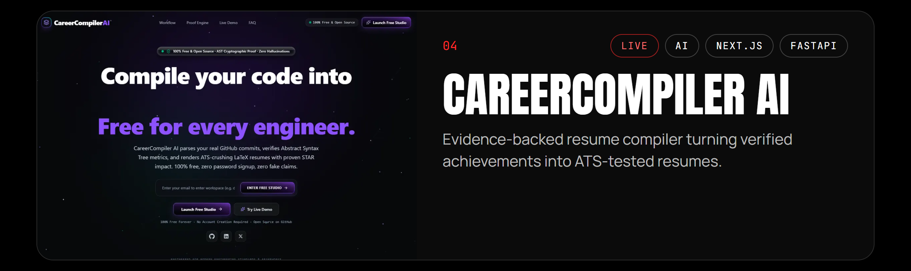</a>

  
  

<a href="https://github.com/NishadCodes18/S.U.T.R.A.-Moving-Traffic-Saving-Lives">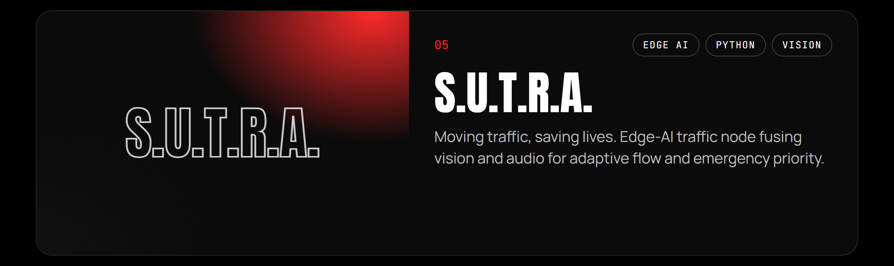</a>

  

<a href="https://github.com/NishadCodes18/PT-TRACKER-WEBSITE">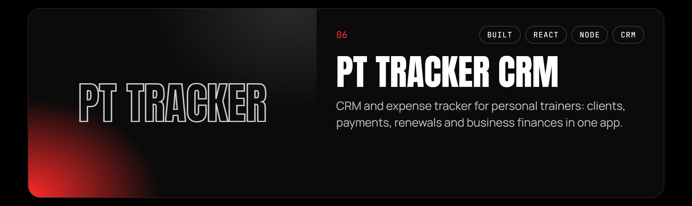</a>

  

<a href="https://github.com/NishadCodes18/Gym-Website">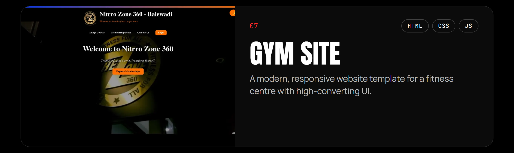</a>

  
  

<a href="https://github.com/NishadCodes18/F1-Website-Simple">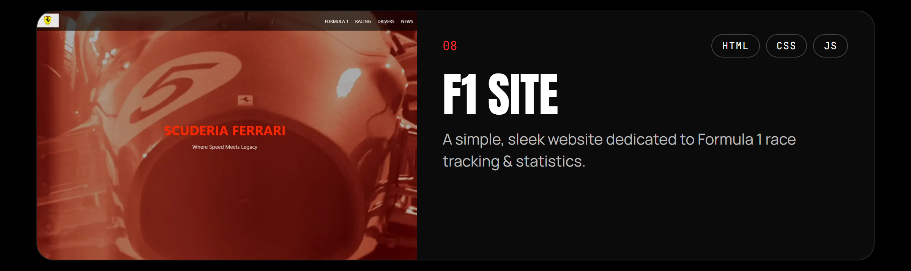</a>

  
  

  

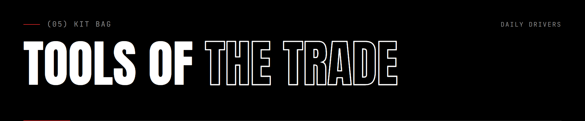

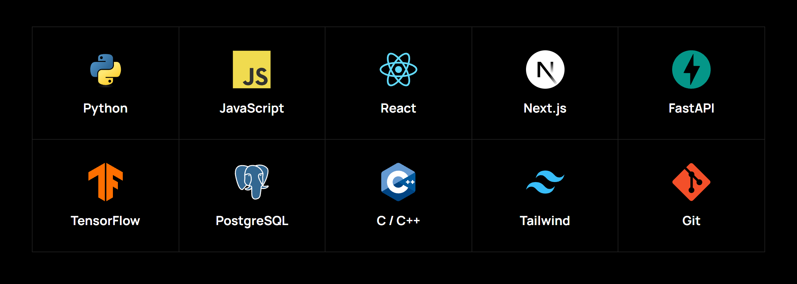

  
  
  
  
  
  
   
  
  
  
  
  
  
   
  
  
  
  
  
  

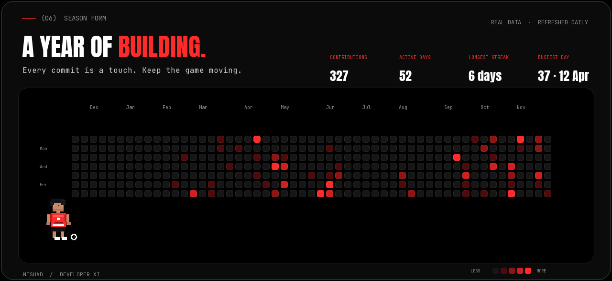

  
  

<a href="https://nishadcodes18-portfolio.vercel.app/#contact">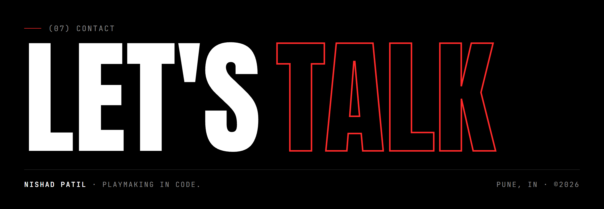</a>

  
  
  
  
  
  

<code>PLAYMAKING IN CODE.</code> · Think like a player. Train like an athlete. Build like an engineer.

